# Kubernetes Course Tasks - Task 1: Multi-Container Pods

## Overview

Deploy a timestamped **hello in MLOPS MENA COMMUNITY** webpage with nginx on a three-node Minikube cluster using Calico. Each Pod has an init container (`init-done`) and two long-running containers (`nginx`, `time-updater`). The sidecar updates nginx's HTML every five seconds by accessing the nginx process's filesystem through `/proc/<PID>/root` **without a shared volume**. The task also deliberately breaks the init container, observes a failed rolling update, then restores the healthy Deployment.

## Project files

```text
Kubernetes-Course-Tasks/
└── Task-1/
    ├── README.md
    ├── deployment.yaml          # Working version
    ├── deployment-failed.yaml   # Init container exits 1 (experiment only)
    └── screenshots/
```

## Configuration

| Requirement | Implementation |
| --- | --- |
| Cluster | Minikube with 1 control plane and 2 workers; Calico CNI |
| Nodes | `minikube`, `minikube-m02`, `minikube-m03` |
| Namespace | `webapp` |
| Deployment | `web-deployment`, 3 replicas |
| Selector and Pod label | `app: web` |
| Init container | `init-done`, `busybox:1.36`, `echo done` |
| Main container | `nginx`, `nginx:1.27`, port 80 |
| Sidecar | `time-updater`, `busybox:1.36` |
| Process visibility | `shareProcessNamespace: true` |
| Sidecar capability | `SYS_PTRACE` |
| HTML file | `/usr/share/nginx/html/index.html` |
| Declared volumes | None (no `volumes` field in the Pod template) |

### Architecture

```text
3-node Minikube cluster (Calico)
└── Namespace: webapp
    └── Deployment: web-deployment (replicas: 3; app: web)
        ├── Pod 1
        ├── Pod 2
        └── Pod 3
            ├── init-done (echo done; exits 0 before app containers start)
            ├── nginx (creates index.html; serves it on TCP/80)
            └── time-updater (finds nginx PID; rewrites index.html every 5s)

Shared process namespace per Pod
    └── Sidecar writes through /proc/<nginx-pid>/root/usr/share/nginx/html/index.html
```

`time-updater` is implemented as a **regular application container acting as a sidecar**. It is not the newer Kubernetes native sidecar form (a restartable init container). The process namespace is shared, but nginx and BusyBox retain their own container filesystems; `/proc/<PID>/root` gives the sidecar a path into nginx's filesystem (subject to Linux permissions and security controls).

## 1. Create and verify the cluster

Prerequisites: Docker Engine, Minikube, and kubectl installed, with Docker access for the non-root Ubuntu user.

```bash
minikube start --driver=docker --nodes 3 --cni=calico --cpus 2 --memory 2200
kubectl get nodes -o wide
kubectl get pods -n kube-system
```

Observed: all three nodes showed `Ready`; Calico node agents and the Calico controller reached `Running`. The scheduler placed the three application Pods across all three nodes in the observed run (this distribution is not guaranteed without scheduling constraints).

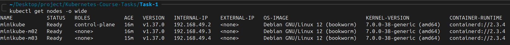

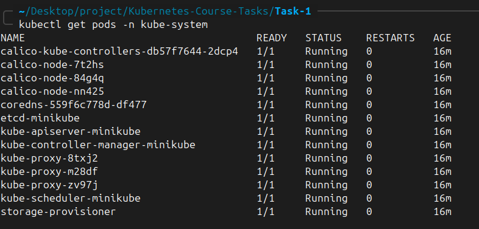

## 2. Create the namespace and deploy

```bash
kubectl create namespace webapp
kubectl get namespace webapp
kubectl apply --dry-run=client -f deployment.yaml
kubectl apply -f deployment.yaml
kubectl get deploy web-deployment -n webapp
kubectl get pods -n webapp -l app=web -o wide
```

Observed: namespace `webapp` was `Active`, Deployment `READY 3/3`, and three Pods `2/2 Running` with zero restarts. The init container runs to completion, so it is **not** counted in the `2/2` readiness total.

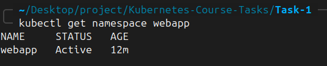

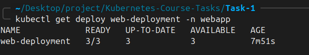

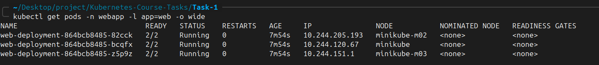

## 3. Verify containers, process sharing, timestamp, and no shared volumes

```bash
kubectl logs deploy/web-deployment -n webapp -c init-done
kubectl exec deploy/web-deployment -n webapp -c time-updater -- ps
kubectl get pods -n webapp -l app=web -o jsonpath='{.items[0].spec.initContainers[*].name} {.items[0].spec.containers[*].name}{"\n"}'
kubectl get deploy web-deployment -n webapp -o jsonpath='Volumes: {.spec.template.spec.volumes}{"\n"}'
```

Results: `init-done` printed `done`; `ps` in the sidecar showed the nginx master and worker processes; container names were `init-done nginx time-updater`; no volumes were declared in the Deployment template.

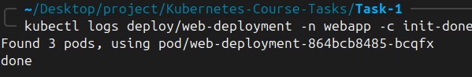

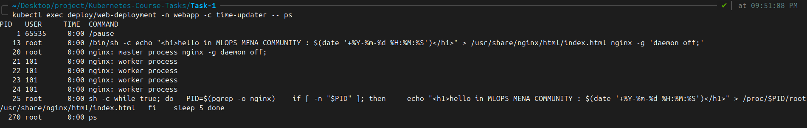

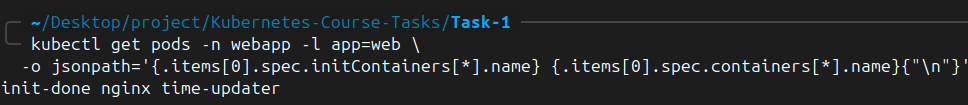

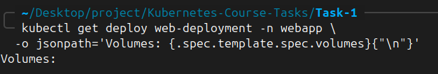

To compare the **same Pod's** HTML contents over time:

```bash
POD=$(kubectl get pods -n webapp -l app=web -o jsonpath='{.items[0].metadata.name}')
kubectl exec -n webapp "$POD" -c nginx -- cat /usr/share/nginx/html/index.html
sleep 6
kubectl exec -n webapp "$POD" -c nginx -- cat /usr/share/nginx/html/index.html
```

The screenshot demonstrates different timestamps on successive reads, consistent with the sidecar's periodic writes. Separate manual reads do not need to differ by exactly five seconds because commands and updater loop run independently.

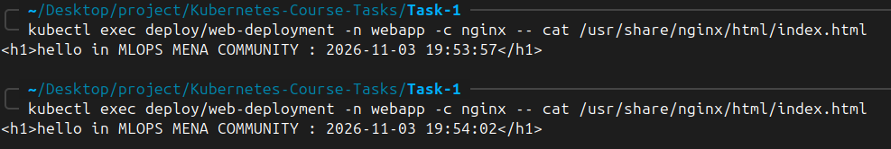

## 4. Access the nginx page

```bash
kubectl port-forward -n webapp deploy/web-deployment 8080:80
```

The HTML displays the container's date/time.

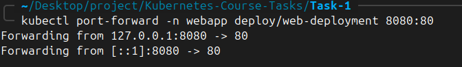


## 5. Experiment: failing init container

The **only intentional difference** between the two manifests is the init-container command:

```yaml
# deployment.yaml
command: ["sh", "-c", "echo done"]

# deployment-failed.yaml
command: ["sh", "-c", "echo 'init failed'; exit 1"]
```

Apply the failed version **without deleting the existing Deployment**:

```bash
kubectl apply -f deployment-failed.yaml
kubectl get pods -n webapp -w
kubectl get deploy,rs,pods -n webapp
```

During the experiment, the new Pod displayed `Init:Error` and, between retries, `Init:CrashLoopBackOff`. The init container printed `init failed` and exited with code `1`, so **nginx and time-updater did not start in the new Pod**. The old three Pods continued as `2/2 Running` and the existing application stayed reachable.

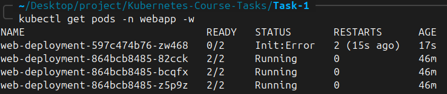


Select the actual new Pod name , then check:

```bash
kubectl logs <failing-pod-name> -n webapp -c init-done
kubectl describe pod <failing-pod-name> -n webapp
kubectl get deploy,rs,pods -n webapp
```

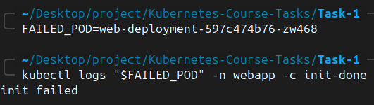

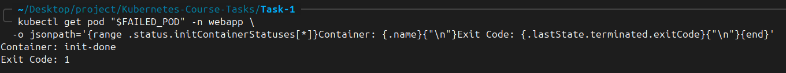

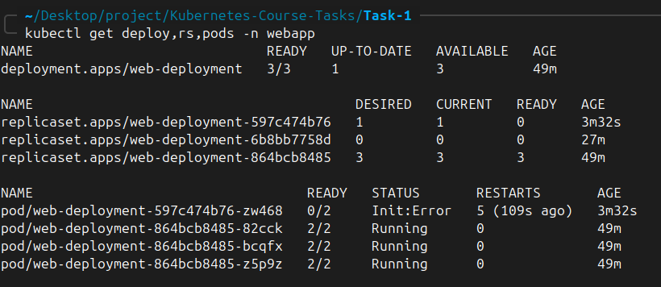

With 3 replicas and the default RollingUpdate strategy, `maxSurge: 25%` rounds up to **1 additional Pod** and `maxUnavailable: 25%` rounds down to **0 unavailable replicas**. The old ReplicaSet therefore kept its three healthy Pods while the new ReplicaSet had a failing Pod. The Deployment could display `READY 3/3`, `UP-TO-DATE 1`, `AVAILABLE 3` even though the rollout was **not complete**.

**Answers to the assignment questions:**

1. **New Pod status:** 
`Init:Error` alternating with `Init:CrashLoopBackOff` while Kubernetes retries the init container.
2. **Do nginx and time-updater start in the new Pod?** 
No. Initialization never succeeds.
3. **Is the page still reachable? Why?** 
Yes in the observed experiment, because the three old healthy Pods remain available under the rolling-update strategy.

## 6. Restore the working Deployment

```bash
kubectl apply -f deployment.yaml
kubectl rollout status deployment/web-deployment -n webapp --timeout=120s
kubectl get deploy,rs,pods -n webapp
```

Observed after recovery: Deployment `READY 3/3`, `UP-TO-DATE 3`, `AVAILABLE 3`; three Pods `2/2 Running`; the failed ReplicaSet remained at zero replicas as rollout history.

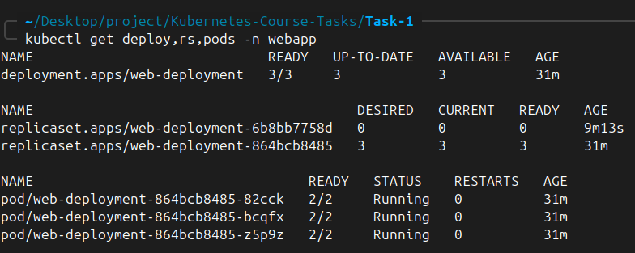
