# Task 2 — FastAPI Guestbook with MySQL on Kubernetes

In this task, I deployed a FastAPI guestbook application with a MySQL database on **Ubuntu**, using a **three-node Minikube Kubernetes cluster**. I created the Kubernetes configuration files myself, tested that the app could read and write messages, and verified that the messages remained in MySQL after its Pod was replaced.

## 1. My setup

I used Docker, Minikube, and `kubectl` on Ubuntu. My Kubernetes cluster had one control-plane node and two worker nodes:

| Node | Role |
| --- | --- |
| `minikube` | Control plane |
| `minikube-m02` | Worker; stores the MySQL volume |
| `minikube-m03` | Worker |

I checked that all nodes were ready before deploying anything:

```bash
minikube start
kubectl get nodes -o wide
```

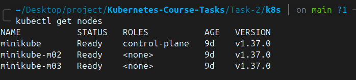

## 2. Project structure

I kept the supplied FastAPI and MySQL application files and added my Kubernetes manifests in `k8s/`. I also kept my terminal and browser screenshots as proof of the steps I completed.

```text
Task-2/
├── README.md             # My step-by-step task documentation
├── webapp/               # FastAPI source code and Dockerfile
├── mysql/                # MySQL Dockerfile, schema, and initialization script
├── k8s/                  # Kubernetes YAML files I created
├── screenshots/          # Selected screenshots used in this README
└── images/               # All 25 screenshots, renamed by their content
```

## 3. Build my Docker images and load them into Minikube

I started from the root of the `Task-2` folder. First, I set the database initialization script's permissions as required for this task. Then I built one image for FastAPI and another for MySQL:

```bash
chmod -x mysql/initdb/01-setup.sh
docker build -t webapp-api:task2 ./webapp
docker build -t webapp-mysql:task2 ./mysql
```

After the builds succeeded, I loaded the images into Minikube so Kubernetes could use them without pulling them from a public registry:

```bash
minikube image load webapp-api:task2
minikube image load webapp-mysql:task2
minikube image ls | grep -E 'webapp-api|webapp-mysql'
```

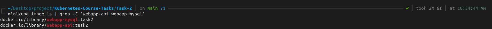

## 4. Create my namespace

I created a namespace named `webapp-stack` to keep my application's Kubernetes resources together. I wrote this definition in `k8s/namespace.yaml` and applied it:

```bash
kubectl apply -f k8s/namespace.yaml
kubectl get namespace webapp-stack
```

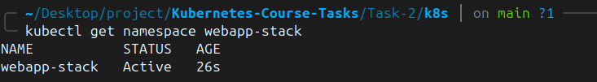

## 5. Create my MySQL Secret and application ConfigMap

I used `k8s/mysql-secret.yaml` to store the **demo** MySQL root password, app username, and app password. I used `k8s/configmap.yaml` for non-sensitive settings such as the application title, environment, database host, port, and database name.

```bash
kubectl apply -f k8s/mysql-secret.yaml
kubectl apply -f k8s/configmap.yaml
kubectl get secrets -n webapp-stack
kubectl get configmaps -n webapp-stack
```

I checked that the Secret had three keys and the ConfigMap had the expected application settings. I did not display password values in my screenshots.

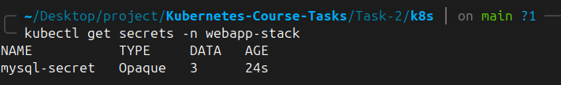

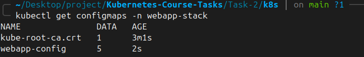

> **Note:** The included Secret uses the assignment's example credentials for a local learning environment. `stringData` does not encrypt secrets. I would not reuse these passwords in production or publish real credentials.

## 6. Configure MySQL persistent storage

I needed the database to keep its data even if its Pod was deleted. For that, I created:

- `mysql-pv`: a **2Gi** PersistentVolume using the `manual` storage class, `ReadWriteOnce` access, and `Retain` reclaim policy.
- `mysql-pvc`: a **2Gi** PersistentVolumeClaim in the `webapp-stack` namespace, bound to `mysql-pv`.

I used a `hostPath` directory at `/data/webapp-mysql` on **`minikube-m02`**, with node affinity so that the MySQL Pod runs on the node containing its data.

```bash
kubectl apply -f k8s/mysql-pv.yaml
kubectl apply -f k8s/mysql-pvc.yaml
kubectl get pv mysql-pv
kubectl get pvc -n webapp-stack
```

I checked that the PV and PVC both showed **`Bound`**.

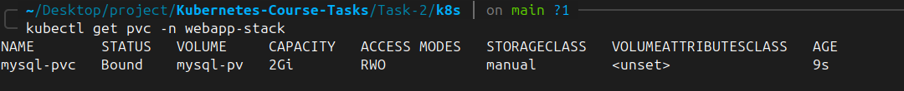

**Why I used this setup:** `hostPath` is suitable for this Minikube exercise, but it is tied to one node. It is not shared, production-grade storage; deleting the storage node could lose the data.

## 7. Deploy MySQL

I created a MySQL Deployment with **one replica** and a `ClusterIP` Service called `mysql` on port **3306**. I set the Deployment strategy to **`Recreate`**, supplied its credentials through the Secret, and mounted `mysql-pvc` at `/var/lib/mysql`.

```bash
kubectl apply -f k8s/mysql-deployment.yaml
kubectl apply -f k8s/mysql-service.yaml
kubectl rollout status deployment/mysql -n webapp-stack --timeout=180s
kubectl get pods -n webapp-stack -o wide
kubectl get svc -n webapp-stack
```

I confirmed that MySQL was running on `minikube-m02` and that the Service was reachable inside the cluster using the name `mysql`.

To inspect the database directly, I used:

```bash
kubectl exec -n webapp-stack deploy/mysql -- sh -c \
  'mysql -uroot -p"$MYSQL_ROOT_PASSWORD" -e "SHOW DATABASES;"'

kubectl exec -n webapp-stack deploy/mysql -- sh -c \
  'mysql -uroot -p"$MYSQL_ROOT_PASSWORD" -e "SELECT * FROM webapp.messages;"'
```

I found the `webapp` database and its initial guestbook messages.

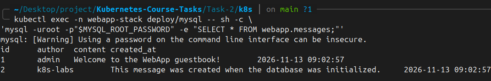

## 8. Deploy FastAPI with two replicas

Next, I deployed the FastAPI application using **two replicas** of the `webapp-api:task2` image. I loaded the app settings through the ConfigMap and the database username and password through the Secret.

I also created a `ClusterIP` Service named `webapp-api`. It listens on port **80** and forwards requests to port **8000** on the FastAPI Pods.

```bash
kubectl apply -f k8s/webapp-deployment.yaml
kubectl apply -f k8s/webapp-service.yaml
kubectl rollout status deployment/webapp-api -n webapp-stack --timeout=180s
kubectl get deployments -n webapp-stack
kubectl get pods -n webapp-stack -o wide
kubectl get svc -n webapp-stack
```

I confirmed that **FastAPI was 2/2 Ready** and **MySQL was 1/1 Ready**.

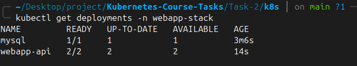

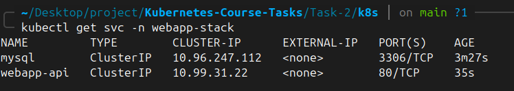

## 9. Enable NGINX Ingress and expose the application

I enabled Minikube's NGINX Ingress addon, then applied my `webapp-ingress` resource. The Ingress uses the `nginx` class and forwards requests for `/` to the `webapp-api` Service on port 80.

```bash
minikube addons enable ingress
kubectl rollout status deployment/ingress-nginx-controller -n ingress-nginx --timeout=180s
kubectl apply -f k8s/webapp-ingress.yaml
kubectl get ingress -n webapp-stack
```

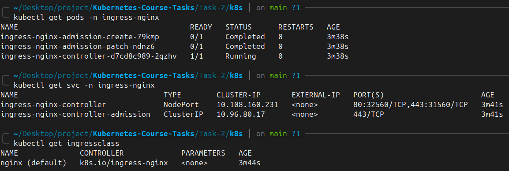

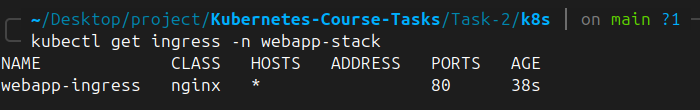

To reach the app from my Ubuntu browser, I used port forwarding. I kept this command running in **Terminal 1**:

```bash
kubectl port-forward -n ingress-nginx svc/ingress-nginx-controller 8080:80
```

I opened **http://localhost:8080** in my browser and saw the guestbook interface.

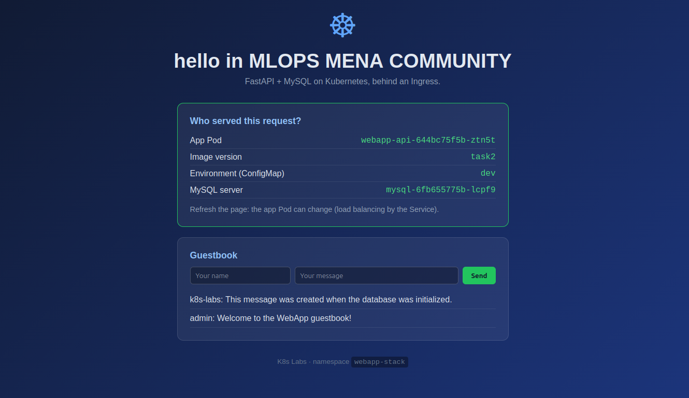

## 10. Test the FastAPI endpoints

With port forwarding still active, I opened **Terminal 2** to test the app:

```bash
curl http://localhost:8080/health
curl http://localhost:8080/api/info
curl http://localhost:8080/api/messages
```

These requests let me verify that FastAPI was running and could retrieve guestbook messages from MySQL.

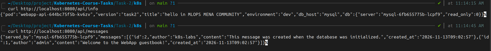

## 11. Prove that the MySQL data survives a Pod restart

This was my main persistence test. I created a guestbook message through FastAPI, deleted **only the MySQL Pod**, waited for Kubernetes to replace it, and checked that my message was still there.

**First, I inserted a message:**

```bash
curl -X POST http://localhost:8080/api/messages \
  -H 'Content-Type: application/json' \
  -d '{"author":"student","content":"Hello from Kubernetes Task 2!"}'

curl http://localhost:8080/api/messages
```

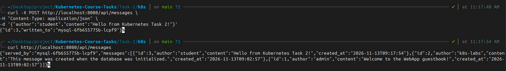

**Next, I deleted the MySQL Pod but kept the PV and PVC:**

```bash
kubectl delete pod -n webapp-stack -l app=mysql
kubectl rollout status deployment/mysql -n webapp-stack --timeout=180s
kubectl get pods -n webapp-stack -o wide
```

The MySQL Deployment automatically started a replacement Pod, using the same persistent storage.

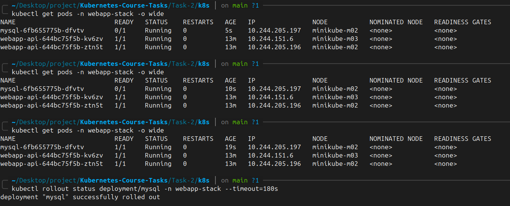

**Finally, I checked my message again:**

```bash
curl http://localhost:8080/api/messages

kubectl exec -n webapp-stack deploy/mysql -- sh -c \
  'mysql -uroot -p"$MYSQL_ROOT_PASSWORD" -e "SELECT * FROM webapp.messages;"'
```

I confirmed that **`Hello from Kubernetes Task 2!`** was still stored after the new MySQL Pod became ready. This showed that the MySQL data was stored on the PersistentVolume instead of being lost when the old Pod was deleted.

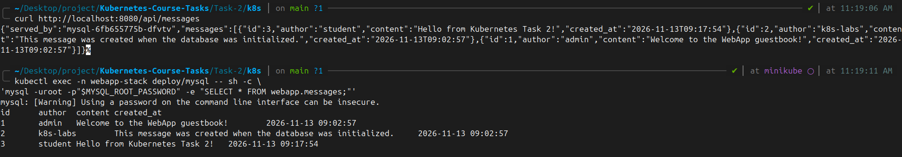